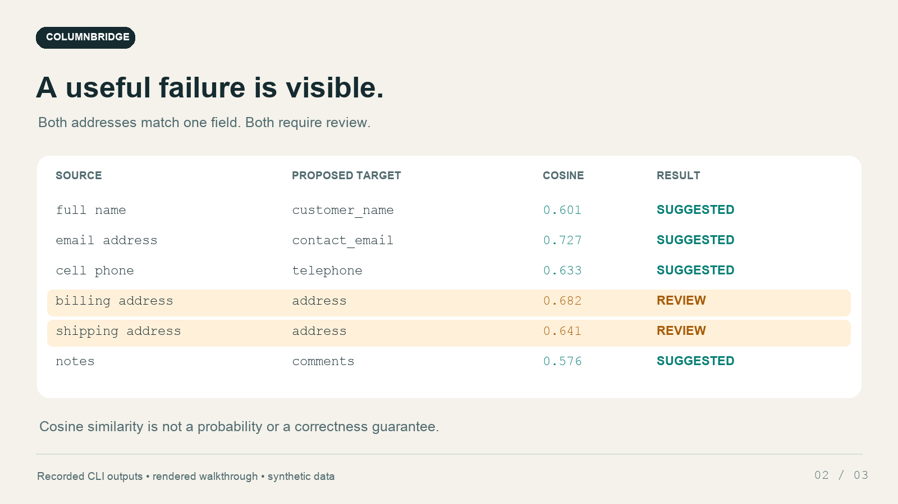

# ColumnBridge

**Match messy CSV headers to your import schema using a small AI model on your own laptop. Review the suggestions before changing a file.**

For a freelancer importing a shop's customer export, `cell phone`, `telephone`, and `contact_number` can mean the same thing. A generic `address` field can also hide a costly billing/shipping mistake. ColumnBridge uses real local sentence embeddings to suggest matches, then makes uncertainty and collisions visible.

This is an original prototype built for Hacktoberfest Open-Source AI Challenge Week 2: Side Hustle. No customer, sale, prize or paid deployment is claimed.

## Demo

[Watch the 36-second walkthrough](https://raw.githubusercontent.com/nnyydct-ship-it/columnbridge/main/demo/columnbridge-demo.mp4). It is rendered from actual saved CLI outputs using synthetic data, not a raw screen recording.



[Published challenge entry](https://dev.to/_360f299373efce95981ebc/columnbridge-local-embeddings-that-stop-before-renaming-the-wrong-csv-column-2n20) — published October 18, 2026, with a fully autonomous AI disclosure. Judging and any prize payment are pending.

## Quick start

Requires Node.js 20+ and npm. Tested here with Node 24 on macOS ARM64.

```sh
npm ci
node bin/columnbridge.js match \
  --input examples/contacts.csv \
  --schema examples/contact-schema.json \
  --out report.json
```

The first run downloads approximately 24 MB of pinned model/tokenizer files from Hugging Face. These requests fetch public model assets; they do not send your headers, schema or rows to an inference API. CPU inference happens inside this Node process. Intra-op threads are configured to 2, inter-op threads to 1, with batches of at most 8 texts and a 128-token limit.

The demo produces genuine model suggestions such as:

```text
full name → customer_name | cosine 0.601 | margin 0.394
email address → contact_email | cosine 0.727 | margin 0.403
cell phone → telephone | cosine 0.633 | margin 0.443
billing address → address | target_collision
shipping address → address | target_collision
```

Exact floating-point scores can vary by runtime. These are observed demo results, not hard-coded mappings or promised accuracy.

## Go offline

After one successful download:

```sh
node bin/columnbridge.js match \
  --input examples/contacts.csv --schema examples/contact-schema.json \
  --out report-offline.json --offline
```

`--offline` disables remote model loading and requests local files only. A missing cache causes an error; there is no network fallback. `--cache-dir /path/to/cache` selects a different model cache. Keep the entire revision directory when moving a cache. A network-denial verification harness in `evidence/` also completed an actual inference run with **0 attempted HTTP/fetch requests**. This is a tested verification condition, not a claim about every future dependency version.

## Your schema

```json
{
  "fields": [
    {"name": "customer_email", "description": "Email address used to contact the customer", "required": true},
    {"name": "order_id", "description": "Unique purchase order identifier"}
  ]
}
```

Names and descriptions are your business definitions. Clear descriptions help the model distinguish similar fields. Only CSV headers and these definitions enter inference. Data rows and sample values are never used to decide a match. The header reader handles quoted delimiters/newlines and BOMs. Duplicate or empty source headers are rejected rather than assigned an ambiguous identity.

Limits: at most 128 source columns and 128 schema fields; 160 characters per name/header; 400 characters per description. Text beyond 128 model tokens is truncated. The model is primarily intended for English; short codes, abbreviations, ambiguous names and other languages may need manual interpretation. This tool does not infer or validate column types, currencies, units or row contents.

## Read the report

`match` writes two local files and leaves the CSV unchanged:

- `report.json`: score, runner-up, margin, alternatives, conflicts, missing required fields and actual model/run metadata.
- `report.json.review.json`: an **unapproved** rename template.

A score is cosine similarity, **not a calibrated probability of correctness**. The defaults (`--min-score 0.48`, `--min-margin 0.08`) are conservative prototype heuristics, not learned business-specific thresholds. A low score or a small gap to the runner-up gets `needs_review`. When two otherwise eligible suggestions claim the same target, both get `target_collision`; the tool never quietly pushes one into its second choice. A weak unknown header does not veto a separate strong suggestion.

Every mapping still needs a person's review, including those labeled `suggested`. Required schema fields are warnings in the report, not proof of a complete valid import.

Reports contain your header names and should be treated as local business data. Existing report/review destinations are atomically replaced with mode 0600; symlinks and hardlinks at those destinations are replaced instead of written through. CSV/schema input paths, including parent-directory aliases, are protected. Reports and review files are separate atomic writes, not one two-file transaction.

## Apply an explicitly reviewed mapping

Edit the review file. Set each uncertain `rename` entry to a chosen schema field or `null` to keep that header. Resolve all collisions, check every suggestion, and only then set `"approved": true`.

```sh
node bin/columnbridge.js apply \
  --input examples/contacts.csv \
  --review report.json.review.json \
  --out normalized.csv
```

`apply` runs without loading a model. It checks the source-header fingerprint, requires an explicit decision for every column and rejects duplicate output names, including collisions with unchanged headers. It refuses to overwrite the input or an existing output and cleans up partial output if parsing fails.

CSV **cell values** are preserved; quoting, newline style and BOM bytes may be serialized differently. This is not a CSV sanitizer. Spreadsheet formula strings and HTML-like text remain unchanged. Review untrusted data before opening it in spreadsheet software.

## Library

```js
import { createLocalEmbedder, matchHeaders } from './src/index.js';

const embedder = await createLocalEmbedder({ offline: true, cacheDir: '.cache/models' });
try {
  const report = await matchHeaders(['email address'], {
    fields: [{ name: 'contact_email', description: 'Email address for a customer' }]
  }, embedder, { offline: true });
  console.log(report.mappings);
} finally {
  await embedder.dispose();
}
```

Model-loading settings are process-global in Transformers.js. Use one model-loading configuration per process. `matchHeaders` also accepts an embedder interface for deterministic tests; the normal CLI always uses the pinned real model, with no string-alias fallback.

## Verification

```sh
npm test
npm run demo
npm run demo:offline
```

The deterministic tests check vector-based ranking, ambiguity, collision rejection, weak-candidate isolation, schema bounds, explicit approval, header fingerprints, CSV logical-value preservation, cleanup on malformed input and file-link overwrite regressions. They deliberately do not hard-code a model's alias predictions. Real inference evidence is separate in `examples/report*.json` and `evidence/`; `evidence/run-summary.json` records measured runtime/memory and model hashes.

## Why open AI is central

The matcher is [`Xenova/all-MiniLM-L6-v2`](https://huggingface.co/Xenova/all-MiniLM-L6-v2), a real open-weight sentence-embedding model, executed with [`@huggingface/transformers`](https://github.com/huggingface/transformers.js) and ONNX Runtime. It embeds both sides, then ranks their cosine similarities. There is no hidden closed-model API, alias dictionary or sample-data upload.

Local inference makes a plausible fixed-price import-cleanup service possible: a freelancer can reuse the tool on confidential client exports with no per-file AI API bill. That is a business hypothesis; no one has paid for this prototype. The explicit review step is part of the service, because a plausible semantic match can still be the wrong business field.

Project code: MIT. **Model weights: Apache-2.0, not MIT.** See [THIRD_PARTY_NOTICES.md](THIRD_PARTY_NOTICES.md).
